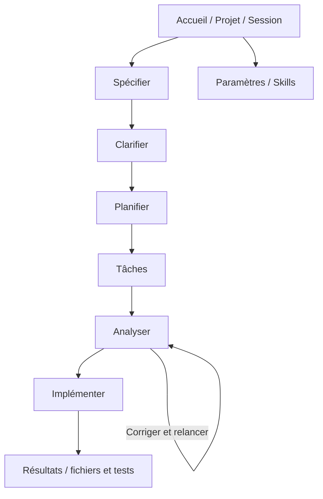

# Navigation et liste des vues

## Navigation simplifiée

## Les 8 écrans
1. **Accueil et connexion** : projet détecté, session nouvelle/dernière/choix, destination, état de Claude/Spec Kit, accès aux skills.
2. **Spécifier** : description libre, aide discrète, exécution, conversation et aperçu `spec.md`.
3. **Clarifier** : question de Claude, propositions A/B/C, recommandé, choix libre, envoi, historique.
4. **Planifier** : hypothèses, stack, commande, réponse progressive et aperçu `plan.md`.
5. **Tâches** : tâches produites et états, accès `tasks.md`.
6. **Analyser** : catégories, chaque problème + cause + correctif recommandé + justification, modifier/approuver/appliquer, relancer.
7. **Implémenter** : skills actifs, autorisations, journal en direct, fichiers touchés, tests, contrôles stop/reprise.
8. **Paramètres et skills** : scanner, sélectionner, périmètre par étape, persistance, destination et options avancées.

## Principes UX
- Barre de progression des 6 étapes en haut ; une action primaire par écran.
- Réponses Claude à droite ou en dessous selon la largeur.
- Utilisateur maître de la décision ; aucun correctif exécuté sans accord.
- Bouton « Voir la commande / Voir le journal » secondaire.
- Indicateur « Session connectée / occupée / interrompue » constant.
- Mention « aperçu simulé » obligatoire pour prototypes.
